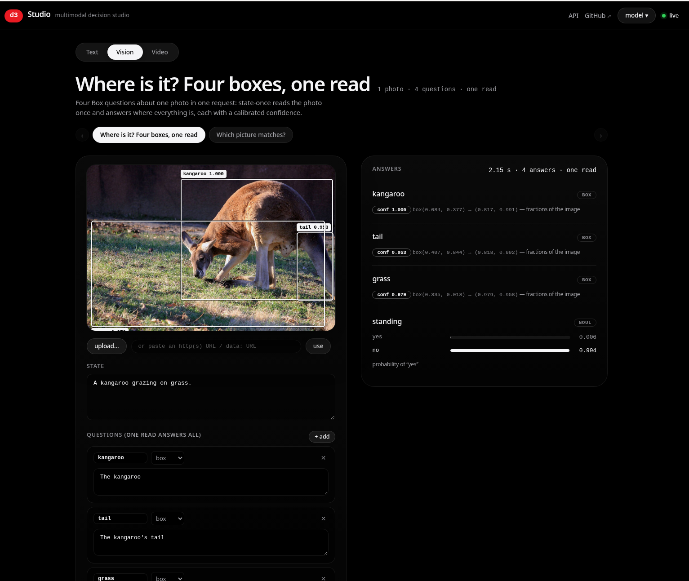

# d3 Studio

A multimodal decision studio for **[vllm-sr/d3-turbo](https://huggingface.co/vllm-sr/d3-turbo)** — the 26B multimodal decision model of Decision 3.0 — in the style of laya-studio. Give it an input (text, an image or a clip), ask it several questions at once, and get a probability for every answer: **choice, yes / no, score**, plus d3-turbo's **box** (where something is, in an image or a video moment) and **track** (where it goes, over a whole clip).

The superpower on show: **state once** — the model reads the input once and answers every question from that read. 1 question or 64, the input is read a single time.

Three studio surfaces:

* **Text** — editable question cards (choice / noul / score), probability bars, state-once timing;
* **Vision** — a photo in the stage, Box overlays drawn on it with calibrated confidence, images inside questions and options (assets by reference);
* **Video** — a clip in the stage, Track rendered as a scrubber: the box follows the target at every sampled moment, with the probability it is visible as a curve.

Everything ships in one process: the [vllm-srun](https://github.com/vllm-project/semantic-router/tree/main/src/model-runtime) runtime (the native transformers engine for the decision models) embedded in a FastAPI app that also serves the studio UI.



## Layout

```
studio/
  app.py          FastAPI app: embeds the runtime, mounts its ASGI contract
                  behind the studio routes (/api/*), serves the UI
  contract.py     deck validation (fail closed) + the public limits report
  examples.json   the curated deck catalog
  media/          CC-licensed deck samples (Wikimedia; attribution below)
  static/         the vanilla-JS UI (index.html, app.js, styles.css)
  tests/          pytest, end-to-end against the tiny turbo fixture
  scripts/
    pull_model.py idempotent pinned-revision pull (the init container runs it)
chart/            Helm chart (Deployment/Service/Route/ServiceMonitor + GPU/MIG)
model-runtime/    build-context copy of semantic-router's src/model-runtime
                  (synced by make image; not committed)
```

## Run locally (no downloads)

The local venv serves the **tiny random-weight turbo package**
(`vllm_srun.testing.decision3`, the `turbo` variant: d3-turbo's exact card —
`prefix_bidir`, Box and Track, images in state, instructions and criteria) on
the CPU. Random weights give garbage probabilities, but every contract, limit
and UI path is real:

```bash
make install   # venv: torch (CPU) + ./model-runtime[multimodal] + fastapi
make serve     # http://127.0.0.1:7860 against the tiny fixture
make test      # 16 API tests, end-to-end on the fixture
```

`make serve-real` serves the real d3-turbo instead (a ~52 GiB HF cache or the
container's pulled weights — not a laptop job).

## The API

The embedded runtime answers the System One contract itself
(`/v1/systemone`, `/v1/models`, `/health`, `/metrics`); the studio adds
`/api/examples` (decks), `/api/status`, `/api/ready` (503 while loading) and
`/api/evaluate` (a loose alias of `/v1/systemone`).

```bash
curl -s localhost:7860/v1/systemone -H 'content-type: application/json' -d '{
  "state": "Ticket: the invoice total is wrong after the plan change.",
  "questions": {
    "route":  {"type": "choice", "instructions": "Which team?",
               "criteria": {"billing": "Billing", "tech": "Technical support"}},
    "urgent": {"type": "noul", "instructions": "Is the customer asking for an urgent fix?"}
  }
}'
```

* images and videos are base64 data URLs (`data:image/jpeg;base64,…`,
  `data:video/webm;base64,…`) in top-level `images` / `videos`;
* images by reference live in `assets` (`{"<a>": {"type": "image",
  "data_base64": …}}`) and are claimed wherever the reference appears in the
  state, a question's instructions or its criteria — only that question reads it;
* `states` answers several states in one call (the batch matrix);
* a failed question fails the request as a whole — `max_length_exceeded` means
  the question ran over its token budget (the UI offers the long-context toggle,
  `options.long_context: true`, which reads up to 131k tokens per question).

## Deploy

The app image carries **deps only** (~8–10 GB); the weights are pulled at pod
start by an **init container** (`studio/scripts/pull_model.py`, idempotent — a
marker file skips the ~52 GiB pull once done) into a shared PVC. tmm has HF
egress; an optional HF token (a Secret reference, never a value in this repo)
speeds the pull.

```bash
make image && make push        # quay.io/eformat/d3-studio:latest
oc create secret generic d3-hf-token -n user-mhepburn --from-literal=token=hf_...   # optional
helm upgrade --install d3-studio chart/ -n user-mhepburn \
  --set image=quay.io/eformat/d3-studio:latest \
  --set gpu.resourceName=nvidia.com/mig-3g.71gb \
  --set hfTokenSecret=d3-hf-token
```

* GPU placement is a chart value: `nvidia.com/mig-3g.71gb` (the largest tmm MIG
  slice, 69.75 GiB — 2.25 GiB under d3-turbo's declared 72 GiB floor, which is
  registry metadata, not enforced; the 48.5 GiB of BF16 weights leave ~15 GiB of
  working room at studio-scale traffic) or `nvidia.com/gpu` for a full H200;
* all knobs are chart values: replicas, pull mode (`pvc` init pull | `emptyDir`
  per-pod), PVC size, HF token secret, resources, route timeout (≥120s), env.

## Media attribution

Deck samples from Wikimedia Commons, the same CC-licensed set the d3-turbo card
uses: Australian Shepherd catching a frisbee by Sally Wehner (CC BY 2.0); two
red panda photos by Mathias Appel (CC0); Common Raccoon in a Tree (CC0); An owl
portrait by Ted Moravec (CC0); Anna's hummingbird in Arizona by Larry & Teddy
Page (CC BY 2.0). Resized/re-encoded for the decks.

## Status

M1+M2 complete (studio + tests green, all three modes QA'd in a browser).
M3 (image) and M4 (deploy to tmm) pending — see `~/.opencode/plan/d3-studio.md`.
